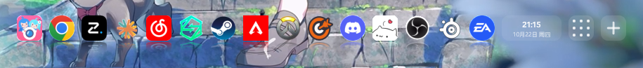
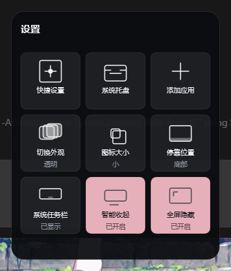

# Dock — 轻量 Windows 桌面 Dock 栏

一个用 **C++20 / Win32 / Direct2D / DirectComposition** 写的原生 Windows Dock。
单进程、静态链接、免安装，空闲时 **0 帧渲染**，几乎不占 CPU。



<p align="center"></p>

> 实测环境：Windows 11 / MSVC 14.44 / Windows SDK 10.0.26100 / CMake + Ninja / 1920×1080 @100%。

## 特性

- **四边停靠**：底 / 顶 / 左 / 右，自动适配分辨率与 DPI，竖排自动切换纵向布局。
- **四档材质**：系统 Acrylic 毛玻璃、纯透明、深色实心、浅色实心。
- **鱼眼动效**：弹簧放大 + 相邻递减 + 向屏内轻抬，收敛即停。
- **图标倒影**：加载期预渲染，绘制期零额外开销。
- **增删排序**：拖入文件、文件对话框添加、右键移除、按住图标拖动排序。
- **悬停标签**：鼠标经过显示应用名，鼠标穿透、不抢焦点。
- **九宫格设置**：快捷设置 / 系统托盘 / 添加应用 / 外观 / 大小 / 位置 / 任务栏 / 智能收起 / 全屏隐藏。
- **日期时间**：时间 + 月日 + 星期，仅分钟变化时重绘。
- **隐藏系统任务栏**：隐藏时 Dock 自动贴到屏幕底边，恢复后自动回到原位。
- **智能收起**：被窗口遮挡时完全隐藏，遮挡消失自动回正；鼠标顶住屏幕边缘并停稳可临时唤出，3 秒无操作自动收回。
- **全屏自动隐藏**：游戏 / 视频 / PPT 全屏时自动隐身，退出即回来。
- **托盘常驻**：左键显示/隐藏，右键完成全部设置。
- **便携**：配置写在 exe 同目录；除开机自启外不写注册表。

## 更多细节

| 能力 | 说明 |
| --- | --- |
| 自适应分辨率 | 条目不超出屏幕：放不下时自动压缩图标与间距（最小 18px），仍放不下也不溢出 |
| 图标尺寸 | 小 36 / 中 44 / 大 52（按 DPI 缩放，按 2× 分辨率取图后下采样，边缘清晰） |
| 启动 | 左键单击图标 → `ShellExecuteExW` |
| 单实例 | 互斥量保护；Explorer 重启后自动重建托盘图标 |
| 开机自启 | 九宫格/托盘菜单开关，写 `HKCU\...\Run\Dock` |

## 右键菜单

托盘图标右键 / Dock 空白处右键：

- 隐藏 Dock
- 位置 → 底部 / 顶部 / 左侧 / 右侧
- 外观 → 毛玻璃 / 透明 / 深色实心 / 浅色实心
- 图标大小 → 小 / 中 / 大
- 图标倒影（开关）
- 隐藏系统任务栏（开关）
- 开机自启
- 九宫格设置（与点 Dock 上的九宫格相同）
- 打开系统托盘
- 移除「某条目」（在图标上右键时出现）
- 添加应用… / 刷新图标 / 打开程序所在文件夹 / 退出

## 外观与动效说明

- **透明模式**：`PanelStyle()` 把底板 fill/border 的 alpha 置 0，`Render()` 直接跳过整个底板绘制，
  只画图标与倒影 —— 这是"图 1 那种悬浮图标"的效果。
- **倒影**：`MakeReflectionWic()` 在加载时把图标缩放→垂直翻转→按 `maxAlpha * t²` 逐行衰减 alpha，
  存成独立位图；`Render()` 里只是一次 `DrawBitmap`，所以静止依旧 0 帧、悬停动画也不额外解码。
- **鱼眼**：`StepAnimation()` 用弹簧（k=170, c=21）把每项 scale 推向目标值，
  目标 = 1 + 0.28 × falloff(距离)，falloff = 1 / 0.22 / 0.06 / 0。
  悬停项同时朝屏幕内侧轻抬 `(scale-1) × iconBox × 0.35`。
- **名称标签**：`ShowLabelFor()` 用 GDI+ 在 32bpp DIB 上画圆角胶囊+文字，预乘 alpha 后
  `UpdateLayeredWindow` 输出；窗口带 `WS_EX_TRANSPARENT | WS_EX_NOACTIVATE`，完全不挡鼠标。
- **任务栏开关**：`SetTaskbarHidden()` 用 `ShowWindow` 直接隐藏 `Shell_TrayWnd`（含副屏 `Shell_SecondaryTrayWnd`），
  并把 `SPI_SETWORKAREA` 设成整屏；`DockArea()` 在隐藏状态下直接返回显示器 `rcMonitor`，
  所以"底部"停靠会贴到屏幕最底；恢复时写回原工作区并重排，Dock 自动回到任务栏上方。
  退出 Dock 时会自动恢复任务栏，避免系统残留隐藏状态。
- **九宫格设置**：主窗口的「九宫格」槽位点击后，用独立 `WS_EX_TOOLWINDOW | WS_EX_NOACTIVATE` 弹出窗口，
  复用主进程的 D3D11 / D2D 设备，自建一条小交换链；按停靠边自动朝屏幕内侧弹出。
  面板固定为 3×3 设置格：快捷设置 / 系统托盘 / 添加应用 / 切换外观 / 图标大小 /
  停靠位置 / 系统任务栏 / 智能收起 / 全屏隐藏，每格直接显示当前值。
  关闭即 `SW_HIDE`，不常驻渲染；按 `ESC` 或点击面板/ Dock 之外会收起。
- **日期时间**：`DrawClock()` 用 DirectWrite 排版；`kClockTimerId` 每 15 秒查一次本地时间，
  只有分钟（或跨天）变化时才重绘，静止时依旧 0 帧。
- **布局缓存**：`LayoutMetrics()` 缓存图标尺寸/间距/倒影结果，悬停动画每 15ms 重绘时不再重复计算；
  仅在图标数量、尺寸、停靠边、DPI 或可用长度变化时失效。

## 构建

需要 **Visual Studio 2022（或 Build Tools）含「使用 C++ 的桌面开发」**、CMake 3.20+ 与 Ninja。

```powershell
# 一条命令：自动定位 vcvars64.bat、配置并编译
powershell -ExecutionPolicy Bypass -File scripts\build.ps1

# 或手动（在 VS 开发者 PowerShell 中）
cmake -S . -B build -G Ninja -DCMAKE_BUILD_TYPE=Release
cmake --build build
```

产物 `build\Dock.exe`（无控制台、静态 CRT、内嵌图标与版本信息）。

打包便携版：

```powershell
powershell -ExecutionPolicy Bypass -File scripts\package.ps1
# dist\Dock-v1.12.zip
```

推送到 GitHub 的 `v*` 标签时，Actions 会自动构建并附到 Release。

**重新编译前请先退出正在运行的 Dock**（否则链接会报 LNK1104 文件被占用）：

```powershell
Stop-Process -Name Dock -Force -ErrorAction SilentlyContinue
```

调试日志：`Dock.exe --debug` 会在同目录写 `dock-debug.log`（记录窗口尺寸、布局、菜单命令）。

## 配置文件（便携，均在 exe 同目录）

| 文件 | 内容 |
| --- | --- |
| `dock-items.txt` | UTF-8，每行一个 exe/lnk/url 路径 |
| `dock-settings.ini` | `material=0..3`、`iconSize=36/44/52`、`edge=0..3`、`autoStart=0/1` |
| `dock-debug.log` | 仅 `--debug` 时生成 |

## 性能实测（1920×1080，16 个条目，透明材质 + 倒影，静置 20s）

| 指标 | 实测 |
| --- | --- |
| 空闲 CPU | ≈ 0（实测 6 秒增量 0.00s；无重绘，仅有低频状态查询） |
| 专用内存 | ≈ 66 MB 空闲 / ≈ 76 MB 打开过一次设置面板后（一次性图形资源，之后开关不再增长） |
| 句柄 / 线程 | 稳定不增长（无泄漏） |
| 静止帧 | 0 帧（动画结束即销毁定时器；全屏隐藏期间连检测定时器也停） |

对比 Electron/Tauri 方案（后者同功能约 120–200 MB 且空闲仍有渲染进程），本实现属于"极轻"档位。

## 已知限制

- 系统 Acrylic 会对**整个窗口矩形**模糊；当前已用圆角裁剪避免四角露出直角亮块。
- 多显示器：目前按主屏工作区定位，副屏全屏不影响主屏 Dock。
- 部分 `.url`（网页快捷方式）本身图标是白底方块，视觉上会有白框——那是图标文件自身的像素，不是渲染问题。

## 代码结构（单文件 `src/main.cpp`）

| 位置 | 内容 |
| --- | --- |
| `wWinMain` | DPI 感知、单实例、窗口创建、消息循环 |
| `CreateDeviceResources` | D3D11/D2D/DComp 初始化、`SetDpi(96)` 使 1 单位 = 1 像素 |
| `CreateTargetBitmap` | 交换链 → D2D 目标位图 |
| `LoadIconBitmap` / `ReloadIcons` | `IShellItemImageFactory` + WIC + D2D 位图 |
| `LayoutMetrics` / `IconRect` / `HitTest` | 布局、自动压缩、命中测试 |
| `PositionDock` | 四边定位（`SPI_GETWORKAREA`） |
| `ApplyMaterial` / `SetAccent` | 四档材质 |
| `Render` | 面板 + 图标 + 「＋」绘制 |
| `BuildMenu` / `HandleCommand` | 托盘与右键菜单 |
| `MoveItem` | 拖动排序（图标位图与动画状态同步迁移，不重新解码） |

## 两个必踩的坑（已修，勿回退）

1. **切换尺寸/位置后画面停在旧帧**（看起来"只剩一个图标""图标溢出面板""换边后图标消失"）：
   `WM_SIZE` 里必须先 `dc->SetTarget(nullptr)` 再 `targetBitmap.Reset()`，然后才 `ResizeBuffers`。
   D2D 设备上下文会一直持有上一帧 target 的引用，不解绑则 `ResizeBuffers` 返回 `DXGI_ERROR_INVALID_CALL`，
   于是窗口变大了、内容仍是旧尺寸，表现为"新旧尺寸混剪"。
2. **150% DPI 下所有绘制被放大 1.5 倍**：`ID2D1DeviceContext` 会继承工厂的桌面 DPI。
   创建后立刻 `SetDpi(96, 96)`，并让所有布局常量乘 `dpiScale`，1 个 D2D 单位严格等于 1 物理像素。
## 分发（发给别人用）

最小可分发包 = **`Dock.exe` 一个文件**（配置与条目会在 exe 同目录自动生成），
建议整成文件夹 + zip 一起发：

```
Dock-v1.12\
  Dock.exe          运行本体（约 410 KB，静态 CRT，免安装）
  使用说明.txt       中文使用/FAQ 说明
  README.md         技术说明（可选）
  app.ico           图标文件（可选，供对方自定义快捷方式）
```

一键打包：`powershell -ExecutionPolicy Bypass -File scripts\package.ps1`

**不要打包** `dock-items.txt`（里面是发送者机器的绝对路径）与 `dock-debug.log`。

### 收件人须知

| 事项 | 说明 |
| --- | --- |
| 放置位置 | 必须可写：桌面、`D:\Tools\Dock`、U 盘；**不要放 `C:\Program Files`**，否则写不了配置 |
| 首次运行 | 双击 `Dock.exe`，托盘出现图标；Dock 初始为空，拖入 exe/lnk 或点「＋」添加 |
| 快捷方式 | 右键 exe → 发送到 → 桌面快捷方式（路径随文件夹变化，故不预置 `.lnk`） |
| 杀软误报 | 未签名小体积 exe 常被启发式误报，可加信任或自行 `signtool` 签名 |
| 运行库 | 无依赖，系统自带 D3D11/D2D 即可（Win10 1809+ / Win11） |

## 毛玻璃失效排查

`material=0` 走系统 Acrylic（`SetWindowCompositionAttribute` + `ACCENT_ENABLE_ACRYLICBLURBEHIND`）。
Windows 设置里关闭「透明效果」（`HKCU\...\Themes\Personalize\EnableTransparency = 0`）时，
API 仍返回成功但实际不模糊，画面表现为深色实心 —— 这是系统行为，不是 Dock 的问题。
需要玻璃效果时先确认该开关为开；想完全去底板则用 `material=1`（透明）。

## 全屏应用自动隐藏（v1.7）

`IsFullscreenForeground()` 只做「读前台窗口矩形 + 类名 + 样式」这类零侵入查询，
不注入、不读别的进程内存，因此不会与反作弊冲突：

1. 前台窗口 `GetForegroundWindow()`，排除自身、桌面壳层（`Progman`/`WorkerW`/`Shell_TrayWnd` 等）
   与 `GetAncestor(GA_ROOT) != fg` 的子窗口；
2. `GetWindowRect` 必须覆盖 `MonitorFromWindow(...)->rcMonitor`（±2px），且只针对 **Dock 所在那块屏**，
   副屏全屏不会影响主屏 Dock；
3. 有 `WS_CAPTION` 的最大化窗口不算全屏（任务栏自动隐藏时它也会铺满整屏）；
4. 最后查 `DWMWA_CLOAKED`（UWP 挂起/虚拟桌面切换的幽灵窗口）——放在最后，普通窗口不付这次 DWM 调用。

触发方式：`SetWinEventHook(EVENT_SYSTEM_FOREGROUND)` 即时响应切窗口，另有 1000ms `SetTimer`
兜底（F11 这类不换前台的情形）。隐藏用 `SW_HIDE`，动画定时器同步停掉，所以全屏期间
Dock 是彻底 0 帧、0 唤醒源。全屏中手动点托盘唤出会置 `fsSuppressed`，
直到切到另一个普通应用窗口才恢复自动隐藏，避免 1000ms 轮询把它立刻收回去。
关闭该开关时 `StopFullscreenWatch()` 会摘掉钩子和定时器，不产生任何周期唤醒。

## 智能收起（v1.8）

目标：**没窗口遮挡时常驻，被遮挡时完全从桌面消失**（不是留一条残影）。

- 判定 `AnyWindowOverDock()`：遍历 Z 序，只要存在「可见 + 顶层 + 有标题栏/应用型 + 与 Dock 区域真实相交（>8px）」的窗口就算被挡。
  优先用最便宜的 `GetWindowRect` 相交做初筛，只有命中的窗口才继续查类名 / `DWMWA_CLOAKED`，
  因此空闲时 700ms 一次轮询仅约 0.1% CPU。
- 收起流程：`opacityTarget = 0` → 滑出工作区 → 动画收尾 `SW_HIDE`，**桌面上不留任何残影**。
- 回正有两条路：
  1. 遮挡消失 → 立刻滑入并淡入（主路径）；
  2. 仍有遮挡但鼠标**顶住屏幕边缘并停稳约 450ms** → 临时唤出（备用路径）；
     鼠标停留在 Dock/面板内会自动续期，离开 3 秒后重新收起。
- 边缘判定只认真正贴住屏幕的 1px 区域，快速划过窗口底部不会误触发；
  在边缘点击（例如最大化窗口的最下方按钮）会进入 800ms 冷却，不抢这次点击。
- 菜单「贴边唤出（需停稳）」可关闭；关闭后不启动边缘检测定时器，零额外唤醒。
- 菜单「被窗口挡住时自动收起」可关闭；关闭后 Dock 常驻，不做任何遮挡检测。

## 渲染健壮性

`Render()` 里的 `PushLayer` / `PopLayer` 曾不配对：透明材质（或切换尺寸时几何体被重置）根本没有 push，
却无条件 pop，Direct2D 会让 `EndDraw` 失败并整帧丢弃 —— 表现为「切到透明后残留旧画面」「换边后只剩一个图标或图标溢出」。
现在用 `layerPushed` 布尔量严格配对，并在 `EndDraw` 失败时记录 HRESULT 并解绑 target，
不再静默丢弃帧。24 次连续「材质 × 位置」切换压力测试 `fail` 计数为 0。

## 许可

[MIT](LICENSE)。欢迎 Issue / PR。

